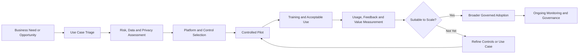

# Governed AI Adoption

## Context

A professional-services organisation wanted to explore generative AI in a practical way while maintaining appropriate controls around privacy, information handling, accuracy and responsible use.

AI tools were becoming increasingly accessible to employees, creating both an opportunity for productivity improvement and a risk that adoption could move faster than organisational governance.

## Challenge

The challenge was not simply whether employees should use AI.

It was creating a practical way to determine:

**Which use cases should proceed, using what information, on which platforms, and under what controls?**

A blanket prohibition would be difficult to sustain, while unrestricted use introduced legitimate concerns around privacy, confidential information, intellectual property, data loss, quality, security and Shadow AI.

## Approach

A staged adoption model was established covering governance, controlled pilot activity, user enablement, measurement and broader rollout.

Controls and guidance included:

- acceptable use;
- information classification;
- privacy and confidentiality;
- data-loss prevention;
- platform assessment;
- Shadow AI;
- human review and accountability;
- bias and hallucination awareness.

A simple assessment model helped keep decisions proportionate:

**Use Case + Data + Risk + Platform**

Pilot activity focused on common knowledge-work scenarios including drafting, analysis, summarisation, technical assistance and quality checking.

The emphasis was not on assigning licences. It was on identifying useful, repeatable patterns while keeping information handling and human oversight visible.

## Governed Adoption Lifecycle

## Measurement

Adoption was considered through both quantitative and qualitative evidence.

Available platform reporting and Microsoft 365 telemetry could support measures such as:

- active and repeat usage;
- adoption trends;
- workload usage;
- repeatable use cases;
- user feedback;
- quality and productivity observations;
- incidents and exceptions.

Microsoft Graph and PowerShell can provide repeatable Microsoft 365 usage reporting where appropriate.

Telemetry is useful evidence, but usage alone does not prove business value.

## Outcome

The organisation gained a repeatable framework for introducing generative AI safely, with clearer expectations for users and improved leadership visibility of adoption, risk and value.

Experimentation could continue while governance remained proportionate to the maturity and risk of each use case.

The scale decision could therefore be based on evidence:

- **Expand** use cases showing repeatable value and acceptable risk.
- **Strengthen controls** where information or operational risk remained.
- **Redesign or stop** low-value or poorly controlled use cases.
- **Measure again** when the use case, data, platform or risk materially changed.

## Key Lesson

> Responsible AI adoption works best when governance is built into enablement rather than treated as a separate approval layer.

AI adoption is ultimately an operating-model problem, not simply a software rollout.

**Governance → Pilot → Adoption → Measurement → Scale**
