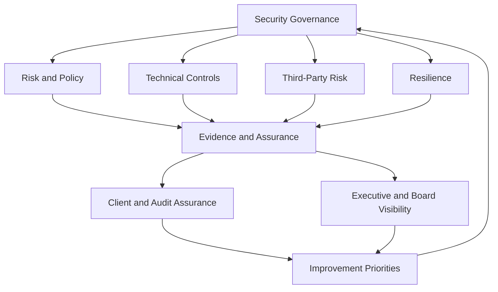

# Building Cybersecurity Maturity & Assurance

## Context

A client-facing organisation operated in an environment where customers and other stakeholders increasingly expected demonstrable evidence of cybersecurity maturity, resilience and effective control operation.

Security therefore needed to support more than internal risk reduction. It also needed to provide confidence to leadership, customers, auditors and other external parties.

## Challenge

The security program needed to satisfy formal assurance requirements while also improving practical operational maturity.

Certification alone was not enough.

Controls needed to:

- operate effectively;
- remain sustainable for the internal team;
- improve resilience;
- produce usable evidence;
- support customer and audit assurance;
- remain proportionate to organisational risk.

The challenge was bringing governance, technical security, resilience and assurance together as one operating capability.

## Approach

A structured security-improvement program was developed across governance, risk management, technical controls, resilience, third-party risk and assurance.

Work included:

- ISO 27001 alignment and recertification activity;
- SOC 2 readiness and assurance support;
- Essential Eight improvement;
- security policy and governance development;
- identity and access controls;
- endpoint and network security;
- information protection and data governance;
- threat monitoring and response;
- third-party security assessment;
- disaster-recovery and resilience exercises;
- evidence collection for audit and customer assurance.

The objective was to make security controls part of normal technology and risk management rather than a collection of activities performed primarily for an audit.

## Security Maturity Operating Model

## Security as Business Enablement

Security assurance increasingly forms part of:

- customer due diligence;
- tender activity;
- contract and renewal discussions;
- third-party assurance;
- broader business development.

This means cybersecurity can contribute directly to organisational trust and commercial capability rather than operating only as an internal control function.

## Executive Visibility

Leadership reporting focused on areas such as:

- material risk;
- security maturity;
- significant incidents;
- control effectiveness;
- resilience;
- remediation;
- investment priorities.

The objective was to translate technical activity into information that supported business decisions.

## Outcome

Security assurance became more structured and repeatable, with clearer evidence of control operation and stronger visibility for leadership and customers.

The organisation became better positioned to respond to certification, assurance and emerging security requirements without treating every request as a separate exercise.

More importantly, security became increasingly connected across:

**Technology + Risk + Data + Resilience + Assurance**

## Key Lesson

> The most valuable security programs connect compliance, operational resilience and customer assurance rather than managing them as independent streams.

Security maturity is a continuing cycle:

**Understand Risk → Implement Controls → Measure → Test → Learn → Improve**

Frameworks provide structure, but the real value comes from turning them into sustainable operating disciplines.
